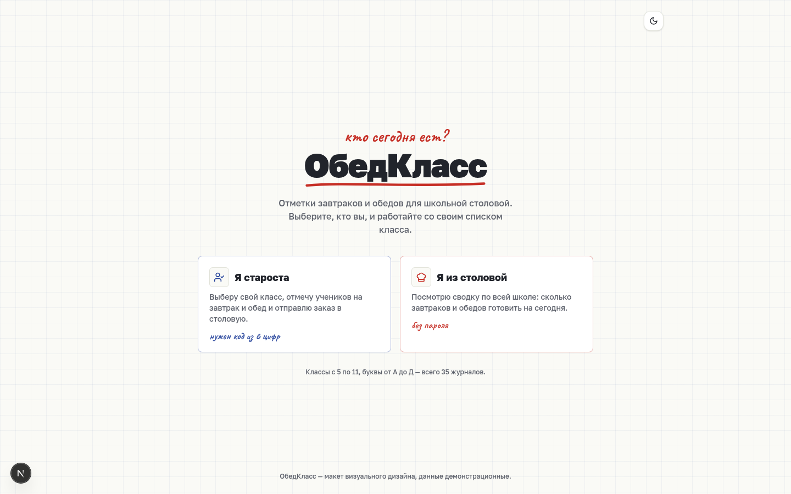
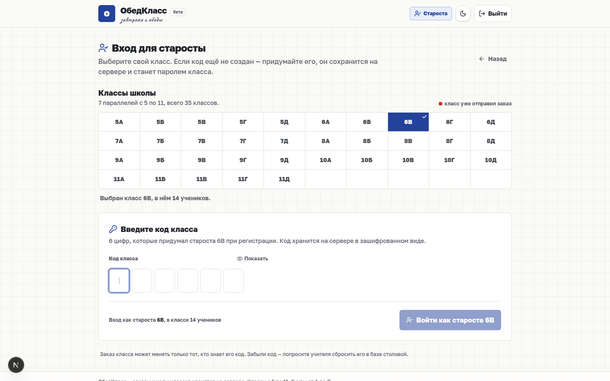
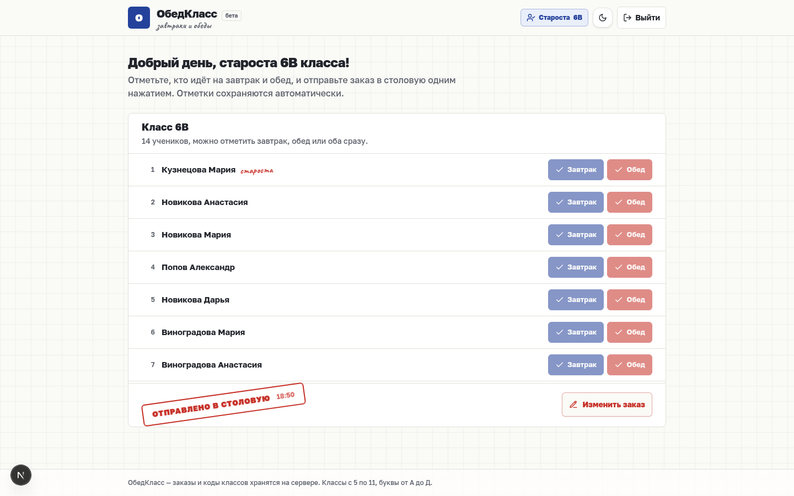
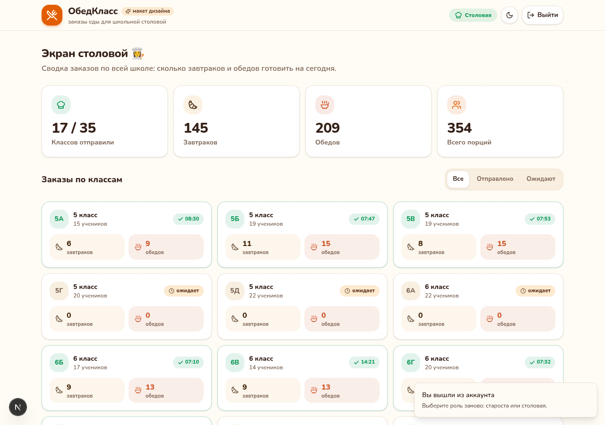
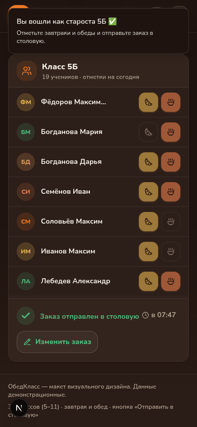

# 🍱 ОбедКласс — заказ еды для школьной столовой

Приложение для онлайн-заказов еды в школьных столовых. В каждом классе есть **староста-админ**:
он отмечает учеников, которые будут завтракать и обедать, и одной кнопкой отправляет заказ в столовую.

> Это **полноценное приложение с бэкендом**: коды классов и заказы хранятся в базе SQLite (Prisma).
> Классы школы: **5–11 параллели, буквы А–Д** — всего 35 классов.

## Как это работает

1. **Вход** — при открытии сайта выбор роли: **«Я староста»** или **«Я из столовой»**.
2. **Староста** — выбирает свой класс. Если код класса ещё не создан — придумывает его
   (6 цифр, хэшируется bcrypt и сохраняется на сервере). Если создан — входит с ним.
   Дальше: отметки «Завтрак» / «Обед» у каждого ученика (сохраняются автоматически),
   быстрые кнопки «Всем завтрак» / «Всем обед» и большая кнопка **«Отправить в столовую»**
   (после отправки заказ можно отредактировать и отправить повторно — время отправки обновится).
3. **Столовая** — живая сводка по всей школе: сколько классов отправило заказ,
   сколько всего завтраков и обедов готовить, статусы по каждому классу с фильтрами
   «Все / Отправлено / Ожидают». Экран обновляется сам каждые 15 секунд.

Сессия старосты хранится 30 дней в подписанной httpOnly-cookie (HMAC-SHA256) —
после перезагрузки страницы вход сохраняется. Заказы хранятся по дням, дата берётся по Москве.

## Скриншоты

| Выбор роли при входе | Вход старосты (класс + код) |
| --- | --- |
|  |  |

| Экран старосты | Экран столовой |
| --- | --- |
|  |  |

Тёмная тема (мобильный вид):



## Стек

- **Next.js 16** (App Router) + **TypeScript**
- **Prisma + SQLite** — коды классов (`ClassAuth`) и заказы по дням (`DailyOrder` + `StudentMark`)
- **bcryptjs** — хэширование кодов классов
- **Tailwind CSS 4** + **shadcn/ui**, иконки Lucide
- Шрифты **Golos Text** и **Caveat** (кириллица), тёмная/светлая темы на `next-themes`
- Списки классов и учеников — детерминированная генерация (`src/lib/school-data.ts`)

## API

| Метод | Путь | Что делает |
| --- | --- | --- |
| GET | `/api/auth/session` | текущая сессия старосты |
| GET | `/api/auth/status?classId=` | зарегистрирован ли код класса |
| POST | `/api/auth/setup` | создать код класса (первый вход) |
| POST | `/api/auth/login` | вход по коду класса |
| POST | `/api/auth/logout` | выход |
| GET | `/api/orders?date=` | все заказы за день (для столовой) |
| PUT | `/api/orders` | сохранить отметки класса (только по сессии) |

## Запуск локально

```bash
bun install
cp .env.example .env
bun run db:push
bun run dev
```

Открыть http://localhost:3000

## Деплой 24/7

Полная пошаговая инструкция — в [DEPLOY.md](DEPLOY.md). Коротко: Vercel (бесплатный
хостинг) + Neon Postgres (бесплатная база через встроенный маркетплейс Vercel).
Понадобятся три переменные окружения: `DATABASE_URL`, `DIRECT_URL`, `SESSION_SECRET`.
Для хостинга используется схема `prisma/schema.deploy.prisma` (PostgreSQL), локально —
`prisma/schema.prisma` (SQLite).

## Структура

```
src/
├── app/                  # страница + API-роуты (auth, orders)
├── components/canteen/   # welcome, вход старосты, шапка, список учеников, экран столовой
├── components/ui/        # shadcn/ui
├── lib/school-data.ts    # школа: 35 классов 5–11, составы учеников
└── lib/session.ts        # подписанные cookie-сессии
prisma/schema.prisma      # ClassAuth, DailyOrder, StudentMark
```

## Планы (следующие шаги)

- [ ] Сброс кода класса учителем (админка столовой)
- [ ] Меню на день и цена порций
- [ ] Печать/экспорт сводки для поваров
- [ ] История заказов по неделям
